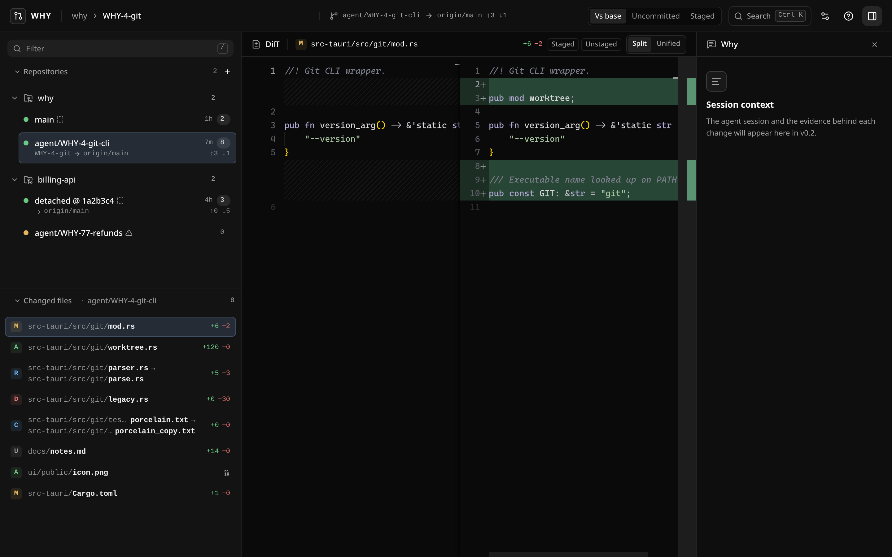

<p align="center"></p>

# WHY

> Because `git diff` tells you what, not why.

[](https://github.com/namdang-fdp/why/actions/workflows/ci.yml)
[](#license)


WHY is a local-first desktop app (Tauri 2 + Rust, React + TypeScript) for humans who review code
written by coding agents (Claude Code, Codex, and others) across many repositories and git
worktrees. It watches the repos your agents are working in and shows you the live diff, with the
goal of attaching the reason behind each change and telling you where to look first.

> [!WARNING]
> **WHY is early software.** v0.2 adds session context to the live diff viewer: what Claude Code
> and Codex did in each worktree, turn by turn, and which turns explain each changed file. Line-level
> provenance and attention signals are planned for v0.3 and later. Builds are Linux only, and Linux
> is the only platform the author develops and tests on. See [Known limitations](#known-limitations).

<p align="center"></p>

## The problem

Coding agents write code fast. A human still has to understand and approve it, so review is now
the bottleneck. `git diff` shows _what_ changed. It does not show the task the agent was given,
why it made a change, whether a block was necessary, or whether the agent drifted from scope. Today
people paste diffs back into the agent's chat and ask "why did you do that?".

WHY aims to answer three questions in one place: what changed, how it changed, and why.

An agent's own explanation can be an after-the-fact rationalisation, so WHY is not meant to explain
every line. The aim is to route a reviewer's attention (unknown origin, heavy churn, untested code,
large deletions, scope drift) and to label every explanation by how well it is backed by evidence.
It never replaces reading the code, and the human always owns the approval.

## Status: what exists today and what is planned

**v0.2.1 is the current release.** It covers the workspace, live-diff and session-context slices of
the roadmap below; everything from v0.3 on is a plan, not a promise. The detailed roadmap is in
[`why-brain/04 - MVP and Validation.md`](<why-brain/04 - MVP and Validation.md>), and every change
is listed in the [changelog](CHANGELOG.md).

| Version | Theme                 | What it is meant to deliver                                                                                                      | State                 |
| ------- | --------------------- | -------------------------------------------------------------------------------------------------------------------------------- | --------------------- |
| v0.1    | Workspace + live diff | Register repos, discover worktrees, diff against the base branch including untracked files, live updates, a Monaco diff view     | v0.1.0, first release |
| v0.2    | Session context       | An event store, a fail-open hook and collector, Claude Code and Codex adapters, a per-session timeline in the inspector          | v0.2.0                |
| v0.3    | Line provenance       | A deterministic replay engine that attributes lines to the edits that produced them, with an accuracy benchmark                  | Planned               |
| v0.4    | Attention             | Signals (unknown origin, churn, untested, large deletion, scope drift), an attention-ordered review queue, per-hunk review state | Planned               |
| v0.5    | Close the loop        | Anchored comments, feedback back to the originating agent, a portable provenance format, first external users                    | Planned               |

The provenance model labels every piece of evidence **Observed**, **Declared**, **Inferred** or
**Unknown**, and never presents a guess as fact. v0.2 applies it to sessions and files; line-level
provenance is v0.3.

### What v0.2 adds

- **Install agent hooks with your consent.** The _Agent hooks_ section of the settings page shows the exact change to your
  user-level Claude Code or Codex config and writes nothing until you confirm. Uninstall restores
  your file. The hook is fail-open: it can never stall or fail your agent.
- **See each agent session** in the inspector: the task, the model, and a live timeline of turns,
  tool calls, edits, shell commands, test runs and subagents. A call with no reported result is
  shown as _unknown_, never as success.
- **See which turns explain each changed file**, which files an agent tried but did not change, and
  which changes no captured agent edit explains.
- **Ask "Why?"** on a turn or tool call to read what the agent said it was doing (labelled
  _Declared_), straight from the agent's own transcript, only when you ask.
- **Codex exit codes** are recovered from Codex's own session log, since its hooks do not carry them.

### What you can do with v0.1

- **Add repositories** with the native folder picker. WHY lists every linked git worktree of each
  one, and picks up worktrees your agents create or remove while it is running.
- **See what changed** in each worktree in three modes: _Vs base_ (since the branch left its base
  branch), _Uncommitted_, and _Staged_. Untracked files are included.
- **Get the base right.** WHY detects the base branch for you and lets you override it per
  worktree.
- **Read the diff in Monaco**, split or unified, and move through files and hunks from the
  keyboard.
- **Watch it update live** while an agent works, without losing your place in the diff.
- **Jump around fast** with the command palette (`Ctrl+K`) and single-key shortcuts (`?` lists them).
- **Make it comfortable:** font, size, line height, ligatures, whitespace and theme are all
  settings.
- **Pick up where you left off:** repositories, base overrides and panel layout are remembered
  between launches.
- **Stay safe:** WHY only reads. See the [safety model](#safety-model-a-passive-observer).

### Known limitations

- **Linux only.** Releases ship an AppImage and a `.deb`. macOS and Windows are untested and have
  no builds.
- **Needs Git 2.45.1 or newer.** Older versions are refused with an error, and some current
  distributions ship an older git (for example Ubuntu 22.04 and 24.04, and Debian 12).
- **Session context covers Claude Code and Codex** (tested with Claude Code 2.1.322 and Codex
  0.170.0). Attribution is per file, not per line, and WHY cannot tell who made a change no agent
  edit explains. Codex hook approval (`/hooks`) is yours to do; WHY cannot read whether it was
  given. See the [changelog](CHANGELOG.md) for the full list.
- **The filter-driver guard has limits** (a config-write race, and trust covers the command string
  only). They are listed in [`SECURITY.md`](SECURITY.md).
- **Unsigned builds, no auto-update.** Check downloads against the published `SHA256SUMS`.

## Install

WHY v0.2.1 ships as a Linux AppImage and a `.deb`. Download one from the
[latest release](https://github.com/namdang-fdp/why/releases/latest); the file names are
`WHY_0.2.1_amd64.AppImage` and `WHY_0.2.1_amd64.deb`.

**Requirements:**

- **Git 2.45.1 or newer** on your `PATH` (check with `git --version`). WHY runs it to read your
  repositories.
- **webkit2gtk 4.1 and GTK 3.** The `.deb` installs `libwebkit2gtk-4.1-0` and `libgtk-3-0` for you.
  The AppImage bundles its own copy.

**Check the download** (optional, recommended). Download `SHA256SUMS` from the same release, then
run this next to the files:

```bash
sha256sum --check --ignore-missing SHA256SUMS
```

**AppImage** (any distribution, nothing is installed):

```bash
chmod +x WHY_0.2.1_amd64.AppImage
./WHY_0.2.1_amd64.AppImage
```

If it fails with a FUSE error, install `libfuse2` (`libfuse2t64` on Ubuntu 24.04) or run it with
`./WHY_0.2.1_amd64.AppImage --appimage-extract-and-run`.

**Debian, Ubuntu and derivatives:**

```bash
sudo apt install ./WHY_0.2.1_amd64.deb
```

Then start WHY from your application menu, or run `why`. To remove it: `sudo apt remove why`.

WHY keeps its databases (registered repositories, and since v0.2 the agent events it captured) in
`~/.local/share/io.github.namdang-fdp.why/`, and the hook binary agents run in
`~/.local/share/why/bin/`. Removing the app deletes neither, and it never modifies your
repositories. **Uninstall the agent hooks from the _Agent hooks_ section of the settings page before you remove the app**,
so your agent config no longer points at the hook.

**Upgrading from v0.1.0:** replace the AppImage (or `sudo apt install` the new `.deb`). Your
registered repositories carry over.

To build from source instead, see [Development](#development).

## Safety model: a passive observer

WHY runs `git` against repositories that agents are actively using, so it is built never to disturb
them.

- **Read-only.** WHY never runs `checkout`, `reset`, `add`, `commit` or any other command that
  writes to a repository.
- **No network.** WHY only issues local Git commands and sets `GIT_NO_LAZY_FETCH=1` to keep
  partial clones from downloading missing objects on demand.
- **One controlled entry point.** Every git call goes through a single runner: arguments are passed
  as an argument vector (never through a shell), concurrency is capped, and each call has a
  timeout.
- **No lock contention.** The runner sets `GIT_OPTIONAL_LOCKS=0`, so `git status` does not take
  `index.lock` and cannot break an agent's own `git add` or `git commit`.
- **Repository config is untrusted.** The runner forces `core.fsmonitor=false`, because a
  repo-local setting can name a program that git would execute during `git status`. Diff commands
  must also pass `--no-ext-diff --no-textconv`.

- **Git filter programs need your OK.** A repository's own config can define _filter drivers_
  (`filter.<name>.clean` / `process`, picked by `.gitattributes`) that git runs while it reads
  files, so merely reading a repository could run a program that an agent wrote there. WHY checks
  before every read and refuses (the repository is shown as blocked, with the programs listed) until
  you choose "Trust and continue". Drivers from your own git config, such as git-lfs, are allowed
  without asking. Details and limits are in [`SECURITY.md`](SECURITY.md).
- **Agent hooks are opt-in and fail-open.** WHY writes its hook only into your user-level agent
  config, only after you approved the exact diff, and the hook always exits successfully within a
  short timeout, so it cannot stall or fail an agent. It captures only from repositories you
  registered, reads transcripts only when you ask "Why?", never reads agent credentials, and sends
  nothing anywhere.

Known limits are listed in [`SECURITY.md`](SECURITY.md), which also explains how to report a
vulnerability.

## Architecture at a glance

- `src-tauri/`: the Rust core, a Cargo workspace. In `src/`: `git/` (all git access), `store/`
  (persistence behind a trait), `ipc/` (Tauri commands), `watch/`, `contracts/` (the types shared
  with the UI), and for agent sessions `collector/` (the socket that receives hook events),
  `adapters/` (Claude Code and Codex payloads to one event model), `events/` (the event store and
  timelines) and `hooks/` (the installer for the agents' user-level hook config).
- `src-tauri/crates/`: `why-hook`, the tiny binary the agents run as a hook (no Tauri; it forwards
  the event and always exits 0), and `why-wire`, the format and paths it shares with the app.
- `ui/`: the React frontend. Its `src/contracts/` folder is generated from the Rust contracts
  with [ts-rs](https://github.com/Aleph-Alpha/ts-rs); do not edit it by hand.
- Design notes and the decision log live in [`why-brain/`](why-brain/), an
  [Obsidian](https://obsidian.md) vault. Start with [`00 - WHY.md`](<why-brain/00 - WHY.md>), then
  [`02 - Architecture and Stack.md`](<why-brain/02 - Architecture and Stack.md>) and
  [`06 - Decisions.md`](<why-brain/06 - Decisions.md>).

## Prior art

WHY is not the first tool in this space: agent workspaces (Conductor, Crystal, Vibe Kanban), vendor
apps that show session context next to diffs, and live-diff viewers each cover a piece of it. The
bet is the combination: harness-agnostic, many repos and worktrees in one place, and evidence-backed
"why". The comparison and sources are in [`why-brain/05 - Research.md`](<why-brain/05 - Research.md>).

## Development

**Prerequisites:** Node 24+, pnpm 10, Rust 1.90+, Git 2.45.1+ (to disable lazy fetching), and the
[Tauri system dependencies](https://v2.tauri.app/start/prerequisites/). On Debian and Ubuntu:

```bash
sudo apt install libwebkit2gtk-4.1-dev build-essential curl wget file libxdo-dev libssl-dev \
  libayatana-appindicator3-dev librsvg2-dev
```

```bash
pnpm i
cp .env.example .env   # optional; defaults work
pnpm dev               # Vite + Tauri window with hot reload
```

| Command              | What it does                                                                                      |
| -------------------- | ------------------------------------------------------------------------------------------------- |
| `pnpm dev`           | Run the app in dev mode (Vite dev server + Tauri window)                                          |
| `pnpm build`         | Production bundle: stages the `why-hook` sidecar (`scripts/stage-hook.mjs`), then `tauri build`   |
| `pnpm test`          | `cargo test --workspace` + `vitest run`                                                           |
| `pnpm lint`          | `cargo clippy -D warnings`, `cargo fmt --check`, `eslint`, `tsc`, `prettier --check`              |
| `pnpm fmt`           | `cargo fmt` + `prettier --write`                                                                  |
| `pnpm fmt:check`     | The two format checks alone                                                                       |
| `pnpm gen:contracts` | Regenerate `ui/src/contracts/` from the Rust contracts                                            |

Layout: `src-tauri/` is the Rust core (a Cargo workspace with `crates/why-hook` and
`crates/why-wire`), `ui/` is the React frontend (Vite root). `pnpm build` passes
`src-tauri/tauri.bundle-hook.conf.json`, which adds `why-hook` as an `externalBin`; plain
`tauri build` without it produces an app that cannot install hooks.

Maintainers: the steps for cutting a release are in
[`docs/release-checklist.md`](docs/release-checklist.md).

**Async rule (Rust):** Tauri already owns a tokio runtime. Don't add `#[tokio::main]` or create a
second runtime; spawn with `tauri::async_runtime::spawn` and use the `tokio` crate only for its
types (process, sync, fs, time).

### Several worktrees at once

Each git worktree needs its own dev port. The port comes from `WHY_DEV_PORT` (default `1420`), read
from the shell or from a gitignored `.env`. Vite serves hot reload on the same port.

```bash
# worktree A
echo WHY_DEV_PORT=1420 > .env && pnpm dev
# worktree B
echo WHY_DEV_PORT=1430 > .env && pnpm dev
```

Or one-off: `WHY_DEV_PORT=1430 pnpm dev`. Note each worktree also compiles its own
`src-tauri/target/`; set `CARGO_TARGET_DIR` to share one if disk space matters.

### Dev instances never touch the installed app's data

A dev run (`pnpm dev`) is a separate **instance** from the installed app, so hacking on WHY cannot
break the copy you use every day:

| What                   | Installed app                       | Dev run on port `P`                          |
| ---------------------- | ----------------------------------- | -------------------------------------------- |
| Data dir (databases)   | `~/.local/share/io.github.namdang-fdp.why/` | the same path with `-dev` appended (shared by all dev ports) |
| Collector socket       | `$XDG_RUNTIME_DIR/why/collector.sock` | `$XDG_RUNTIME_DIR/why/collector-dev-P.sock` |
| Hook spool             | `<data dir>/spool/`                 | `<data dir>/spool-P/`                        |
| Hook binary            | `~/.local/share/why/bin/why-hook`   | `~/.local/share/why/bin/dev-P/why-hook`      |

Without `$XDG_RUNTIME_DIR` the socket goes to `<data dir>/run/`. Dev and installed hooks can be
installed side by side; each install and uninstall touches only its own instance's entries. Because
all dev ports share one data dir, a dev build with a newer database schema makes older dev builds
refuse to open it (the installed app is unaffected).

## Contributing

Bug reports and ideas are welcome as [issues](https://github.com/namdang-fdp/why/issues). Please
read [`CONTRIBUTING.md`](CONTRIBUTING.md) before opening a pull request, and note the
[Code of Conduct](CODE_OF_CONDUCT.md). If you point a coding agent at this repo, it should read
[`AGENTS.md`](AGENTS.md) first.

## License

Licensed under either of [Apache License, Version 2.0](LICENSE-APACHE) or [MIT license](LICENSE-MIT)
at your option.

Unless you explicitly state otherwise, any contribution intentionally submitted for inclusion in
this project, as defined in the Apache-2.0 license, shall be dual licensed as above, without any
additional terms or conditions.

## Acknowledgements

Built on [Tauri](https://tauri.app), [React](https://react.dev), [Tailwind CSS](https://tailwindcss.com),
[shadcn/ui](https://ui.shadcn.com) and [Radix UI](https://www.radix-ui.com). The multi-worktree
navigation and live-diff ideas are inspired by Orca and LGTM.
