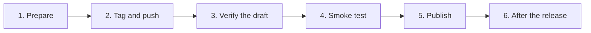

# Release checklist

How to cut a WHY release. Written for v0.1.0; for a later version, replace `0.1.0` everywhere.

The pipeline is [`.github/workflows/release.yml`](../.github/workflows/release.yml). Pushing a tag
`v*` builds the Linux bundles and creates a **draft** GitHub release. Nothing is public until you
publish the draft by hand (step 5).



## 1. Prepare (before tagging)

- [ ] Every PR that belongs in the release is merged into `main`, including WHY-39 (the git
      filter-driver guard) and WHY-43 (this release prep). CI is green on `main`.
- [ ] `SECURITY.md`, the README safety section and `CHANGELOG.md` agree about the WHY-39 guard.
- [ ] `CHANGELOG.md`: in the `## [0.1.0]` section replace `YYYY-MM-DD` with the release date and
      resolve every `TODO(...)`. The workflow refuses to release otherwise.
- [ ] The screenshot `assets/screenshots/why-v0.1.png` is committed, and the README renders it (see
      [`assets/screenshots/README.md`](../assets/screenshots/README.md) for how it was made). It
      shows demo data only. A live-update GIF is planned after v0.1.
- [ ] Versions agree. This also runs in CI and in the workflow:

  ```bash
  node scripts/check-versions.mjs --tag v0.1.0
  ```

- [ ] Up to date and clean, with everything passing locally:

  ```bash
  git switch main && git pull --ff-only
  pnpm install --frozen-lockfile
  pnpm lint && pnpm test
  ```

- [ ] **Dry run** the pipeline: GitHub → Actions → **Release** → **Run workflow** on `main`. It
      builds exactly what a tag would, but creates no release. Check that the run is green and that
      its artifacts `linux-bundles` and `SHA256SUMS` look right (step 3 lists what to expect). Fix
      problems now: a bad tag is awkward to undo.
- [ ] GitHub settings are ready (owner only): private vulnerability reporting is enabled (the
      advisory links in `SECURITY.md` return 404 until it is), secret scanning and push protection
      are on, and the repository description and topics are set.
- [ ] Dependabot: decide what to do with open PRs and alerts so they do not land in the middle of a
      release. Nothing needs to be merged for a release.

## 2. Tag and push

Tag the commit on `main` that you tested, with an **annotated** tag (it records who tagged and
when). The tag name must be `v` plus the version in `package.json`.

```bash
git switch main && git pull --ff-only
git status                       # must be clean
git log -1 --oneline             # the commit you mean to release
git tag -a v0.1.0 -m "WHY v0.1.0"
git show v0.1.0 --stat | head    # tag message, then the commit
git push origin v0.1.0
```

Open Actions → **Release** and watch it. It has two jobs:

1. **Build Linux bundles** (about 15 to 30 minutes on a cold cache). It checks the versions, that
   the tag is on `main` and that the CHANGELOG section is complete, then builds and creates the
   draft release.
2. **SHA256SUMS** downloads the assets from the draft, checks them against the sums computed from
   the build, and attaches `SHA256SUMS` to the draft.

If a check fails the message says what to fix. Do not move a tag that has been pushed. Instead
delete the draft release and the tag (see "Backing out" below), fix the problem on `main` and tag
again.

## 3. Verify the draft

GitHub → Releases shows the draft (only you can see it). Check:

- [ ] It is a **Draft** and **not** marked pre-release. Title is `WHY v0.1.0`, the tag is `v0.1.0`,
      and the target is the commit on `main` you intended.
- [ ] The body is the `## [0.1.0]` section of `CHANGELOG.md`, followed by the install line, with no
      `TODO` and no `YYYY-MM-DD`.
- [ ] Exactly **three** assets, and nothing else (no `.rpm`, `.sig` or `latest.json`):

  | Asset                      | Expected size (v0.1.0 local build) |
  | -------------------------- | ---------------------------------- |
  | `WHY_0.1.0_amd64.AppImage` | about 112 MiB (100 to 130 MiB)     |
  | `WHY_0.1.0_amd64.deb`      | about 6 MiB (4 to 8 MiB)           |
  | `SHA256SUMS`               | 2 lines, about 200 bytes           |

  A size far outside these ranges means something is missing from, or doubled in, the bundle.

- [ ] Download the three files into an empty folder (from the draft page in your browser, which is
      signed in) and check them:

  ```bash
  sha256sum --check SHA256SUMS
  ```

  Both lines must say `OK`. The same files are also in the workflow run's `linux-bundles` and
  `SHA256SUMS` artifacts.

- [ ] Look inside the `.deb`:

  ```bash
  dpkg-deb -I WHY_0.1.0_amd64.deb     # Package: why, Version: 0.1.0, Depends: libwebkit2gtk-4.1-0, libgtk-3-0
  dpkg-deb -c WHY_0.1.0_amd64.deb     # contains usr/bin/why, a .desktop file and icons
  ```

## 4. Smoke test (owner)

Test **both** bundles, ideally on a machine or VM that is not your development setup, so a missing
library shows up. Use a throwaway repository, not one you care about:

```bash
git --version                         # must be 2.45.1 or newer
mkdir /tmp/why-smoke && cd /tmp/why-smoke
git init -b main repo && cd repo
git config user.name smoke && git config user.email smoke@example.com
printf 'one\ntwo\nthree\n' > notes.txt && git add . && git commit -m init
git worktree add ../agent-wt -b feature/agent-wt
```

Do each step for the **AppImage** (`chmod +x`, run it) and again for the **`.deb`**
(`sudo apt install ./WHY_0.1.0_amd64.deb`, start it from the menu and from a terminal with `why`).

- [ ] **Launches.** A WHY window opens, showing the first-run "add a repository" state. The
      `.deb` adds a menu entry with an icon. Note anything printed in the terminal.
- [ ] **Adds a repo.** Add `/tmp/why-smoke/repo` with the native folder picker. Both worktrees
      (`main` and `feature/agent-wt`) are listed.
- [ ] **Monaco renders under the production CSP.** This is the one item that has only been checked
      by reading the build so far. Edit a file in `agent-wt`
      (`echo four >> /tmp/why-smoke/agent-wt/notes.txt`), select it, and confirm the diff editor
      draws the two sides with syntax colour and its icons (fold arrows, gutter markers). A blank
      or never-finishing editor means the CSP blocked the editor's worker or font: stop the
      release, and run the binary from a terminal to capture the output.
- [ ] **Diff modes and base.** Keys `1`, `2`, `3` switch Vs base, Uncommitted and Staged. Open the
      base popover, choose another base, and confirm the diff changes. `Ctrl+K` opens the palette
      and `?` shows the shortcuts.
- [ ] **Live update.** With the diff open, append another line from a terminal. The row flashes and
      the diff updates without the editor jumping back to the top. Then `git add` it and commit
      it: the file moves between modes and disappears from Uncommitted.
- [ ] **Does not disturb the repository.** While WHY has been open, there is no
      `/tmp/why-smoke/repo/.git/index.lock`, and `git -C /tmp/why-smoke/repo status` is clean
      apart from your own edits. The index timestamp does not change when you only look:

  ```bash
  stat -c '%y' /tmp/why-smoke/repo/.git/index   # note it, click around in WHY, run it again
  ```

- [ ] **Restart persistence.** Quit WHY and start it again. The repository is still listed, the
      base you chose is still selected, and the panel layout is restored.
- [ ] **Old git (optional).** If you have a git older than 2.45.1, put it first on `PATH` and
      confirm WHY shows a clear error and still does not touch the repository.
- [ ] **Uninstall.** `sudo apt remove why` removes the binary and the menu entry (check
      `which why`). For the AppImage, delete the file and any desktop entry your launcher made. In
      both cases `~/.local/share/io.github.namdang-fdp.why/` (the database) stays: confirm that,
      then delete it by hand. The test repositories are untouched.

If anything here fails, do **not** publish. Note what failed, back out (below), fix it and tag
again.

## 5. Publish

- [ ] On the draft: confirm **Set as the latest release** is ticked and **pre-release** is not,
      then click **Publish release**. (This is the only step that makes anything public.)
- [ ] Re-run the key check from the public side, signed out or in a private window: the three
      assets download, and `sha256sum --check SHA256SUMS` passes.

### Backing out (before publishing only)

Delete the draft in the GitHub UI, then remove the tag:

```bash
git push origin :refs/tags/v0.1.0
git tag -d v0.1.0
```

Once a release is public, do **not** reuse or move its tag. Fix forward with `v0.1.1`, and if the
release is harmful, mark it as a pre-release or delete it and say why in a new release's notes.

## 6. After the release

- [ ] The README on `main` renders with both screenshots, and the Install links
      (`releases/latest`) work now that a release exists.
- [ ] `CHANGELOG.md`: the `[Unreleased]` and `[0.1.0]` link references at the bottom resolve (they
      404 until the tag exists). Add the next entries under `## [Unreleased]`.
- [ ] Update the status wording in the README if needed (badge and "Status" section) and note the
      release in `why-brain/` (the design vault, which workers cannot edit).
- [ ] Kaneo: close WHY-43 and WHY-39, and move the follow-ups (provenance work for v0.2, any
      smoke-test findings, macOS and Windows builds) to the backlog.
- [ ] Triage Dependabot: the `sha2` bump (PR 6) and the open alerts, with the findings from the
      WHY-43 report.
- [ ] Watch the issue tracker for install problems in the first days (git version, FUSE, missing
      webkit2gtk are the likely ones) and answer them in the README if they repeat.
- [ ] Workflow artifacts from the dry run expire after 14 days on their own.
