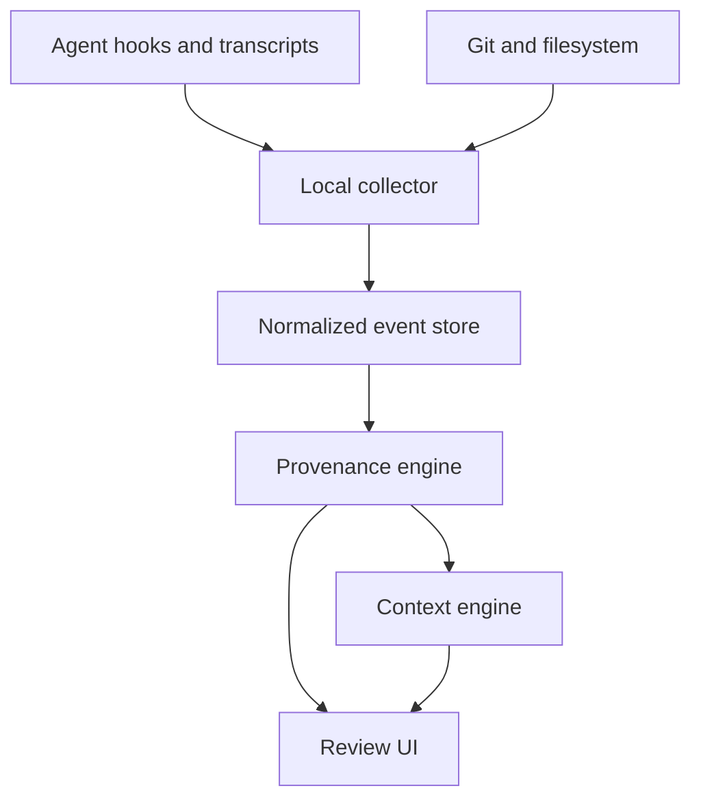

# Architecture and Stack
Up: [[00 - WHY]]

## Proposed stack
| Layer | Choice |
|---|---|
| Desktop | Tauri 2 |
| Native core | Rust, Tokio, serde / serde_json |
| Frontend | React + TypeScript + Vite |
| UI | Tailwind CSS, shadcn/ui, Lucide, Zustand |
| Diff | Monaco Editor |
| Git | Git CLI initially |
| Watcher | notify, reconcile/debounce |
| DB | SQLite (rusqlite, WAL, migrations, FTS5 as needed) |
| Optional later | Tree-sitter, React Flow, Motion |

## Data flow

Keep a modular monolith: git/worktree, agent adapters, collector, storage, provenance, context, review UI. Separate typed contracts so agents can implement in parallel. Tauri IPC/events for UI updates; no cloud server required.

## Data model
Repository, Worktree, Session, Turn, Event, Edit, Snapshot, Decision, LineOrigin, Evidence, Review. Stable worktree identity from canonical path + git metadata, not branch name alone.
SQLite is embedded, ideal for local app state and indexed relational queries. One collector queues/batches writes; WAL supports concurrent readers. Use Git for code history, content-addressed files for large snapshots, and original JSONL or retained excerpts for evidence. Don't duplicate huge logs blindly.

## Portability
Provenance/decisions must not assume local-only. Use stable IDs and content hashes (not absolute paths or SQLite rowids) so records can be serialized to a self-contained, versioned format: git notes, commit trailers, or a checkpoint file attachable to a PR. A reviewer who didn't run the agent and lacks the transcript could then see the evidence. Export/sync is later; the schema supports it now.

## Integration
Passive observer (outside any agent's harness). Claude Code and Codex first (v0.2); Antigravity feasibility in v0.5; OpenCode/others later. Hooks enqueue events quickly; background collector reconciles Git/filesystem. No need to launch agents inside WHY. No credentials collection or implicit network upload.
